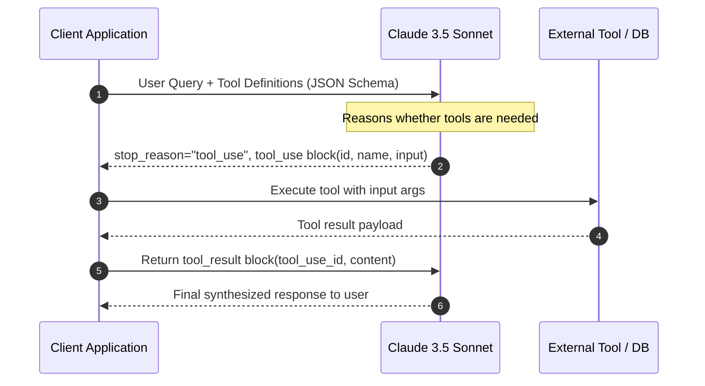

# Claude Platform 101: Recommended Practices, System Architecture & Prompt Design

> **Official Anthropic Claude Academy Master Reference Guide**  
> Comprehensive handbook on Claude platform capabilities, prompt engineering methodologies, tool integration, and cost/latency optimization.

---

## 📑 Table of Contents
1. [Claude Model Family & Selection Matrix](#1-claude-model-family--selection-matrix)
2. [Anthropic Prompt Engineering Golden Rules](#2-anthropic-prompt-engineering-golden-rules)
3. [The XML Tag Architecture](#3-the-xml-tag-architecture)
4. [Role Assignment & System Prompts](#4-role-assignment--system-prompts)
5. [Scratchpad & Chain of Thought (`<thinking>`)](#5-scratchpad--chain-of-thought-thinking)
6. [Prefilling the Assistant's Response](#6-prefilling-the-assistants-response)
7. [Few-Shot Prompting with Canonical Examples](#7-few-shot-prompting-with-canonical-examples)
8. [Tool Use & Function Calling Architecture](#8-tool-use--function-calling-architecture)
9. [Prompt Caching & Enterprise FinOps](#9-prompt-caching--enterprise-finops)
10. [Vision & Multimodal Best Practices](#10-vision--multimodal-best-practices)
11. [Hyperparameters & Sampling Guidance](#11-hyperparameters--sampling-guidance)
12. [Common Anti-Patterns & How to Fix Them](#12-common-anti-patterns--how-to-fix-them)

---

## 1. Claude Model Family & Selection Matrix

Anthropic designs the Claude 3 and 3.5/3.7 model family along a Pareto frontier balancing intelligence, latency, and cost:

| Model Tier | Ideal Workloads | Context Window | Relative Cost | Latency Profile |
| :--- | :--- | :--- | :--- | :--- |
| **Claude Opus** | High-complexity reasoning, complex multi-document synthesis, executive strategy, deep research | 200K tokens | Premium ($$$) | ~30–50 tps |
| **Claude Sonnet** *(Workhorse)* | Advanced coding, full-stack architecture, complex agentic workflows, function calling, multimodal analysis | 200K tokens | Balanced ($$) | ~60–90 tps |
| **Claude Haiku** | High-volume triage, fast classification, streaming chat, sub-agent micro-tasks, extraction pipelines | 200K tokens | Ultra-low ($) | ~120–180+ tps |

### Architectural Decision Rule:
> Use **Haiku** for high-volume routing, parsing, and classification; dispatch to **Sonnet** for agentic reasoning and code synthesis; escalate to **Opus** only when complex multidimensional ambiguity requires maximum semantic depth.

---

## 2. Anthropic Prompt Engineering Golden Rules

Anthropic's core prompt engineering philosophy differs subtly but critically from other LLM providers:

1. **Be Direct, Clear, and Explicit**: Claude responds best to clear, unambiguous instructions. Avoid flowery or poetic phrasing when requesting technical tasks. Treat Claude like a highly competent, brilliant colleague who lacks context.
2. **Give Claude Context Before Instructions**: Place your background knowledge, reference documents, or domain rules **before** the task description.
3. **Use Structured Delimiters (XML Tags)**: Claude was pre-trained extensively on XML-structured prompts. XML tags remove ambiguities between system instructions, user inputs, and examples.
4. **Give Claude Room to Think**: Complex reasoning degrades if forced to output answers immediately. Enforce a `<thinking>` scratchpad stage.
5. **Prefill When Strict Formatting Is Mandatory**: If you want JSON, prefill Claude's response turn with `{`. If you want a specific schema, prefill the root key.

---

## 3. The XML Tag Architecture

XML tags are the definitive syntactic standard for Claude. They prevent prompt injection, eliminate ambiguity, and allow clean programmatic parsing of responses.

### Canonical Tag Structure:
```xml
<system>
You are an expert distributed systems engineer reviewing backend PRs.
</system>

<context>
The microservice handles payment webhooks with an idempotency key stored in Redis.
</context>

<instructions>
1. Review the provided diff for concurrency race conditions and Redis TTL pitfalls.
2. Structure your review into:
   - Critical Vulnerabilities
   - Performance Bottlenecks
   - Approved Suggestions
3. Wrap your analytical process in <thinking> tags before producing the final response.
</instructions>

<examples>
<example>
<input>
def handle_event(key):
    redis.set(key, "processing")
</input>
<ideal_output>
<critical>Missing TTL on idempotency key may lead to permanent deadlock if worker crashes.</critical>
</ideal_output>
</example>
</examples>

<user_input>
${DIFF_CONTENT}
</user_input>
```

### Key XML Rules:
- **Always nest tags cleanly**: e.g., `<examples><example><input>...</input><output>...</output></example></examples>`.
- **Use semantic names**: `<guidelines>`, `<constraints>`, `<schema>`, `<thinking>`, `<final_answer>`.
- **Parse cleanly in code**: Use regex (`re.search(r'<final_answer>(.*?)</final_answer>', text, re.DOTALL)`) or XML element tree libraries.

---

## 4. Role Assignment & System Prompts

Claude's system prompt sets the epistemic baseline, tone, perspective, and behavioral boundaries:

### Best Practices:
- **Specify Role, Expertise, and Audience**:  
  *Good*: "You are a Staff Reliability Engineer writing a post-mortem review for VP-level leadership."  
  *Bad*: "Be a helpful assistant."
- **Define Explicit Negative Constraints ("What NOT to do")**:  
  "Do not invent synthetic metrics. If latency data is missing, output `[TELEMETRY_UNAVAILABLE]`."
- **Define Tone & Brevity**:  
  "Adopt a neutral, concise engineering tone. Avoid pleasantries, preamble, or boilerplate disclaimers."

---

## 5. Scratchpad & Chain of Thought (`<thinking>`)

For non-trivial reasoning (math, code evaluation, logic puzzles, policy enforcement), forcing immediate answers induces hallucinations because autoregressive models generate token-by-token without lookahead.

### Scratchpad Pattern:
```xml
Respond in two phases:
1. In <thinking> tags, break down the user request:
   - Identify all constraints.
   - List potential edge cases (null inputs, timeouts, token limits).
   - Trace intermediate calculations step-by-step.
   - Audit your preliminary answer against the guidelines.
2. In <answer> tags, output only the verified, production-ready solution.
```

### Why Claude Excels with This:
- Tokens generated inside `<thinking>` become **KV-cached context** for the subsequent `<answer>` tokens.
- You can programmatically strip `<thinking>` before displaying the answer to end users, keeping the UI pristine while leveraging full Chain-of-Thought benefits.

---

## 6. Prefilling the Assistant's Response

In the Anthropic Messages API (`/v1/messages`), you can populate the final `assistant` message in the `messages` array. Claude will continue generation directly from that prefilled prefix!

### Common Prefilling Use Cases:

#### 1. Guaranteed Valid JSON Output:
```python
messages = [
    {"role": "user", "content": "Extract customer details from the text: ..."},
    {"role": "assistant", "content": "{\n  \"customer_id\":"}
]
# Claude immediately continues: "10492",\n  "name": "Jane Doe"...}
```

#### 2. Skipping Conversational Fluff:
```python
messages = [
    {"role": "user", "content": "Explain raft consensus in 3 bullet points."},
    {"role": "assistant", "content": "1."}
]
# Claude skips "Sure, here are 3 points!" and generates the first bullet point immediately.
```

#### 3. Enforcing XML Output Tags:
```python
messages = [
    {"role": "user", "content": "Analyze the log stream..."},
    {"role": "assistant", "content": "<analysis>\n<incident_severity>"}
]
```

---

## 7. Few-Shot Prompting with Canonical Examples

Zero-shot prompts rely on general priors; few-shot prompts align style, nuance, and structural adherence.

### Anthropic Guidelines for Examples:
1. **Provide 2 to 5 diverse examples**: Cover standard cases, edge cases, and negative cases (e.g., how to handle bad input).
2. **Use XML encapsulation**:
   ```xml
   <examples>
     <example>
       <input>Order #101 delayed due to carrier strike.</input>
       <classification>LOGISTICS_EXCEPTION</classification>
       <urgency>HIGH</urgency>
     </example>
     <example>
       <input>Can I change my delivery address to 42 Wallaby Way?</input>
       <classification>ADDRESS_MUTATION</classification>
       <urgency>MEDIUM</urgency>
     </example>
   </examples>
   ```
3. **Consistency**: Ensure formatting across examples is identical to the requested output format.

---

## 8. Tool Use & Function Calling Architecture

Claude 3/3.5/3.7 models are fine-tuned natively for JSON schema-based tool calling.

### Workflow Pipeline:


### Best Practices for Tool Definitions:
- **Extensive Descriptions**: Explain *when* and *why* to invoke the tool, and *what the parameters represent*. Claude reads tool descriptions as instructions.
- **Strict Parameter Schemas**: Use `required` fields and enum constraints in JSON Schema.
- **Handling Tool Errors**: When a tool execution fails, return `is_error: True` in the `tool_result` block so Claude can gracefully retry, recover, or explain the issue to the human.

---

## 9. Prompt Caching & Enterprise FinOps

Anthropic's Prompt Caching allows caching the static prefix of long prompts (system prompts, large codebase context, extensive tool schemas, long PDFs) with a 5-minute TTL.

### Economic & Latency Impact:
- **Read cost**: **90% discount** compared to base input token cost.
- **Write cost**: 25% premium on initial cache write.
- **TTFT (Time To First Token)**: Up to **80% latency reduction** on cached requests.

### Implementation Rule:
Add `"cache_control": {"type": "ephemeral"}` to large static blocks:
```python
system=[
    {
        "type": "text",
        "text": LONG_SYSTEM_PROMPT_OR_KNOWLEDGE_BASE,
        "cache_control": {"type": "ephemeral"}
    }
]
```
Ensure static cached content precedes dynamic variables!

---

## 10. Vision & Multimodal Best Practices

Claude supports high-resolution image and multi-page document parsing (PDFs as images or native document tokens).

### Recommendations:
1. **Resolution**: Keep images under 1568px on the longest side to avoid downsampling while minimizing token consumption.
2. **Document Processing**: For scanned forms or tables, instruct Claude explicitly:
   ```xml
   Transcribe tables into Markdown table format preserving exact column headers and row alignment. If a cell is blank or illegible, write [BLANK] or [ILLEGIBLE].
   ```
3. **Spatial Queries**: Use relative visual anchors ("In the upper right corner diagram...") rather than coordinate guessing.

---

## 11. Hyperparameters & Sampling Guidance

| Parameter | Recommended Value | When to Use |
| :--- | :--- | :--- |
| `temperature: 0.0` | 0.0 | Code generation, data extraction, deterministic JSON, classification |
| `temperature: 0.3 - 0.5` | 0.3 - 0.5 | Agent reasoning, technical analysis, architectural reviews |
| `temperature: 0.7 - 1.0` | 0.7 - 1.0 | Creative copywriting, brainstorming, synthetic data variation |
| `max_tokens` | Always set explicitly | Avoid token cutoff mid-generation. Budget sufficient headroom for `<thinking>`. |

*Note: Anthropic recommends adjusting either `temperature` or `top_p`, not both simultaneously.*

---

## 12. Common Anti-Patterns & How to Fix Them

| Anti-Pattern | Why It Fails | Anthropic Recommended Fix |
| :--- | :--- | :--- |
| **"You are an AI that knows everything"** | Vague epistemic boundaries; causes generic outputs | Specify precise persona, domain, expertise level, and audience |
| **Burying dynamic user input inside instructions** | Model confuses user input with operational instructions | Wrap input in `<user_input>` or `<data>` XML tags at the end |
| **Asking for JSON without prefill or schema** | Markdown wrappers (````json ... ````) or conversational preamble | Use response prefill with `{` or provide strict tool/JSON schema |
| **Forcing immediate complex answers** | Model cannot backtrack tokens once emitted | Use `<thinking>` scratchpad tags for intermediate chain-of-thought |
| **Static prompt regeneration on every call** | Paying full input token rates for repeated docs | Enable `cache_control: {"type": "ephemeral"}` for 90% savings |
