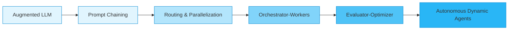

# Building Effective Human-Agent Teams: Architectural Patterns & Collaboration Frameworks

> **Anthropic Claude Academy Reference Guide & Systems Playbook**  
> Based on Anthropic's foundational research on *Building Effective Agents* and Human-AI collaboration topologies.

---

## 📑 Table of Contents
1. [Core Philosophy: Workflows vs. Autonomous Agents](#1-core-philosophy-workflows-vs-autonomous-agents)
2. [The 5 Canonical Agentic Workflow Archetypes](#2-the-5-canonical-agentic-workflow-archetypes)
3. [Autonomous Agents: The ReAct Dynamic Loop](#3-autonomous-agents-the-react-dynamic-loop)
4. [Human-in-the-Loop (HITL) Architectural Patterns](#4-human-in-the-loop-hitl-architectural-patterns)
5. [Team Topologies: Structuring Human-Agent Partnerships](#5-team-topologies-structuring-human-agent-partnerships)
6. [Active Disambiguation & Clarification Protocols](#6-active-disambiguation--clarification-protocols)
7. [Cognitive Load Management for Human Teammates](#7-cognitive-load-management-for-human-teammates)
8. [Failure Modes, Guardrails & Sandboxing](#8-failure-modes-guardrails--sandboxing)
9. [Telemetry, Audit Logs & Reproducibility](#9-telemetry-audit-logs--reproducibility)

---

## 1. Core Philosophy: Workflows vs. Autonomous Agents

Anthropic advocates for **building the simplest system that solves the problem**:



### The Key Distinction:
- **Workflows**: Systems where LLMs and tools are orchestrated through **predetermined, deterministic programmatic code paths** (DAGs, conditional branches). High predictability, low operational variance, easy to test.
- **Agents**: Systems where LLMs **dynamically determine their own execution paths**, deciding which tools to call, what sub-tasks to create, and when to terminate. High adaptability, higher operational variance, requires rigorous safety guardrails.

> **Anthropic Rule of Thumb**: Start with deterministic workflows first. Only transition to fully autonomous agents when the task space has high combinatorial complexity and cannot be mapped into a finite state graph.

---

## 2. The 5 Canonical Agentic Workflow Archetypes

Anthropic defines 5 proven design patterns for augmented LLM systems:

### 1. Prompt Chaining (Sequential Decomposition)
Decomposing a complex task into sequential steps where each LLM invocation handles one phase, passing verified output to the next.
- **Best For**: Multi-step document synthesis, code review (Linting -> Security -> Performance), ETL data hygiene.
- **Gate**: Add programmatic validation checks between chain links.

### 2. Routing (Categorize & Specialize)
An initial classifier model (e.g. Claude Haiku) inspects the prompt and directs it to a specialized prompt or model (e.g. Claude Sonnet with domain tools).
- **Best For**: Complex customer support hubs, multi-language processing, intent classification.

### 3. Parallelization (Sectioning & Voting)
- **Sectioning**: Splitting a large task into independent concurrent sub-tasks (e.g. parallel doc summarization).
- **Voting**: Querying multiple instances or prompts simultaneously to aggregate consensus or detect anomalies.
- **Best For**: High-throughput document processing, multi-judge LLM evaluations, red-teaming.

### 4. Orchestrator-Workers
A central orchestrator LLM breaks a user request into sub-tasks, dispatches them dynamically to worker LLMs, and synthesizes the worker outputs into the final deliverable.
- **Best For**: Full-stack code feature generation (Database worker, API worker, Frontend worker), multi-source market intelligence.

### 5. Evaluator-Optimizer Loop
A generator LLM produces candidate solutions, while an evaluator/critic LLM critiques the output against formal rubrics. The generator refines until criteria are met or max iterations are reached.
- **Best For**: Formal contract generation, high-precision translation, code generation with unit test feedback.

---

## 3. Autonomous Agents: The ReAct Dynamic Loop

When a static DAG cannot anticipate every state, an autonomous agent operates in a continuous loop:

$$\text{Thought} \longrightarrow \text{Action (Tool Call)} \longrightarrow \text{Observation} \longrightarrow \text{Reflection}$$

```
                ┌────────────────────────────────┐
                │        User Objective          │
                └───────────────┬────────────────┘
                                │
        ┌───────────────────────▼───────────────────────┐
        │  1. Reason: Formulate plan in <thinking>      │
        └───────────────────────┬───────────────────────┘
                                │
        ┌───────────────────────▼───────────────────────┐
        │  2. Act: Select & invoke external tool(s)     │
        └───────────────────────┬───────────────────────┘
                                │
        ┌───────────────────────▼───────────────────────┐
        │  3. Observe: Ingest execution payload/errors  │
        └───────────────────────┬───────────────────────┘
                                │
                 [Goal Satisfied?]
                 /               \
              No /                 \ Yes
                /                   \
        [Loop Back]          [Deliver Final Output]
```

### Essential Guardrails for the Dynamic Loop:
- **Max Iterations / Recursion Depth**: Hard limit (e.g. max 15 steps) to prevent infinite loops.
- **Budget Thresholds**: Max input/output token cost budget per task run.
- **Timeout Caps**: Enforce wall-clock timeouts on tool executions.

---

## 4. Human-in-the-Loop (HITL) Architectural Patterns

Effective human-agent teams do not eliminate humans; they **amplify human capability while preserving human agency and control**.

### The 4 HITL Control Gates:

| Pattern | Description | Trigger Condition | Example |
| :--- | :--- | :--- | :--- |
| **Pre-Action Approval Gate** | Agent pauses execution before state-mutating actions | Irreversible operations (Write, Delete, Execute, Financial transfer) | "I've drafted the schema migration. Approve executing on production DB?" |
| **Active Disambiguation Gate** | Agent pauses when user intent is underspecified | Ambiguity score > threshold, or missing prerequisite information | Asking user: "Target iOS 16 or iOS 17 minimum deployment?" |
| **Confidence-Based Escalation** | Agent executes autonomously on high-confidence paths, escalates edge cases | Self-assessed confidence < 85%, or tool error recovery failed | Escalate complex legal indemnity clause to human attorney |
| **Interrupt & Steering Gate** | Human can pause, inspect, modify in-flight variables, and resume | Human notices sub-optimal strategy in execution log | Redirecting agent from brute-force search to index scan |

---

## 5. Team Topologies: Structuring Human-Agent Partnerships

Anthropic outlines three primary organizational topologies for human-agent teams:

### Topology A: The Pair Collaborator (Copilot)
- **Dynamic**: Real-time back-and-forth dialogue.
- **Human Role**: Director and decision-maker.
- **Agent Role**: Context-aware assistant providing suggestions, completions, and instant lookups.
- **Typical Interface**: Chat pane, IDE inline assistant, interactive notebook.

### Topology B: The Delegator & Autonomous Specialist
- **Dynamic**: Asynchronous task handoff.
- **Human Role**: Defines the mission, sets constraints, reviews final deliverables and receipts.
- **Agent Role**: Executes multi-step workflows, manages sub-agents, gathers empirical data, reports back.
- **Key Requirement**: High-fidelity progress telemetry and reproducible execution logs.

### Topology C: The Auditor & Automated Worker
- **Dynamic**: Agent handles 90%+ of high-volume standard operations; human audits anomalies.
- **Human Role**: Quality controller, exception handler, policy updater.
- **Agent Role**: Primary high-speed operational processor.
- **Typical Use Case**: Content moderation, invoice reconciliation, tier-1 customer support triage.

---

## 6. Active Disambiguation & Clarification Protocols

A major cause of agent failure is **unwarranted assumptions**. Anthropic trains agents to recognize ambiguity early rather than guess:

### The Disambiguation Checklist for Agents:
1. **Is the requirement underspecified?** (e.g., "Build an auth system" without specifying JWT, Session, OAuth).
2. **Are there destructive side effects?** (Overwriting existing files, deleting resources).
3. **Are there conflicting constraints?** (Asking for sub-50ms latency with heavy cryptographic hashing).

### Prompt Pattern for Clarification:
```xml
<instruction>
If the user's intent is ambiguous or multiple valid architectural trade-offs exist:
1. DO NOT make arbitrary assumptions on irreversible details.
2. Present 2 to 3 distinct options with trade-offs.
3. Recommend the best option and explain why.
4. Wait for explicit confirmation before executing mutations.
</instruction>
```

---

## 7. Cognitive Load Management for Human Teammates

Raw agent transcripts overwhelm human reviewers with thousands of tokens of tool outputs and internal trace logs. **Effective agents protect human attention.**

### Practices for Human-Digestible Communication:
- **Lead with the Outcome**: Provide the executive summary and key findings first.
- **Diffs Over Full Dumps**: Display file diffs (`unified diff`) rather than printing 500 lines of modified code.
- **Expose Rationale, Not Raw Thoughts**: Condense `<thinking>` into 2–3 clear bullet points justifying architectural decisions.
- **Highlight Open Questions**: Explicitly flag any pending assumptions or unverified edge cases.

---

## 8. Failure Modes, Guardrails & Sandboxing

### Common Agent Failure Modes & Remediations:

| Failure Mode | Root Cause | Anthropic Remediation |
| :--- | :--- | :--- |
| **Tool Calling Hallucination** | Agent invokes non-existent tools or parameters | Strict JSON Schema validation; return clear error messages into agent context |
| **Rabbit Hole / Spin Loops** | Agent repeats failing tool calls with minor variations | Loop detector: flag if same tool called with identical args $\ge 3$ times; force escalation |
| **Context Window Overflow** | Accumulating megabytes of raw tool logs in message history | Summarize or prune intermediate tool outputs before re-feeding into context |
| **Unauthorized Action Scope** | Agent attempts shell commands or network calls outside sandbox | Air-gapped execution environment; strict whitelist of allowed domains and directories |

---

## 9. Telemetry, Audit Logs & Reproducibility

Every autonomous agent run in production must generate an immutable audit trail:

### Minimum Telemetry Payload:
```json
{
  "run_id": "agent-run-20261013-0042",
  "model": "claude-3-5-sonnet-20241022",
  "duration_seconds": 14.8,
  "total_tokens": { "input": 8420, "output": 1250, "cached_read": 6500 },
  "cost_usd": 0.0245,
  "steps_taken": 4,
  "hitl_approval_granted": true,
  "tools_invoked": ["search_codebase", "run_linter", "propose_diff"],
  "outcome_status": "SUCCESS"
}
```

This telemetry enables quantitative evaluation, regression detection, and continuous improvement.
