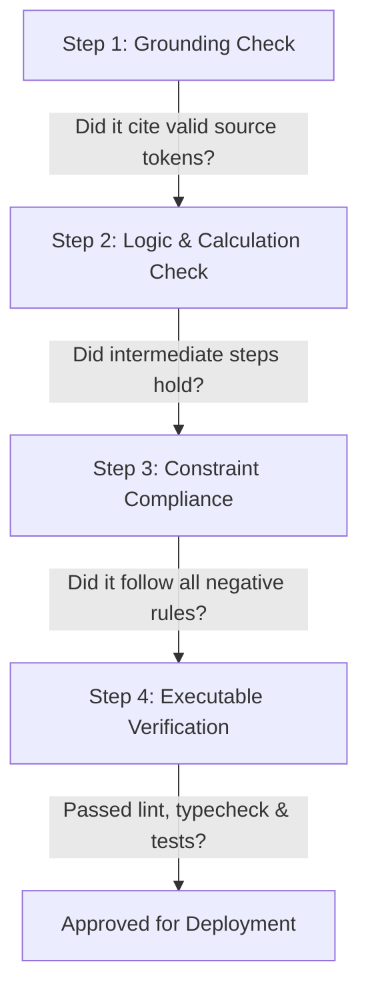

# AI Fluency: Frameworks, Foundations & Critical Systems Thinking

> **Anthropic Claude Academy Reference Guide & Competency Blueprint**  
> Foundational frameworks for mastering human-AI collaboration, task delegation, critical evaluation, and ethical systems design.

---

## 📑 Table of Contents
1. [Defining AI Fluency](#1-defining-ai-fluency)
2. [The 4 Core Pillars of AI Fluency](#2-the-4-core-pillars-of-ai-fluency)
   - [Pillar 1: Delegation (Scoping & Boundary Setting)](#pillar-1-delegation-scoping--boundary-setting)
   - [Pillar 2: Description (High-Fidelity Intent Formulation)](#pillar-2-description-high-fidelity-intent-formulation)
   - [Pillar 3: Discernment (Critical Evaluation & Verification)](#pillar-3-discernment-critical-evaluation--verification)
   - [Pillar 4: Development (Iterative Optimization & Systems Building)](#pillar-4-development-iterative-optimization--systems-building)
3. [Mental Models for LLM Cognitive Mechanics](#3-mental-models-for-llm-cognitive-mechanics)
   - [Next-Token Prediction Reality vs. Reasoning Illusion](#next-token-prediction-reality-vs-reasoning-illusion)
   - [Context Window Dynamics & Attention Decay](#context-window-dynamics--attention-decay)
   - [The Sycophancy Problem & How to Counter It](#the-sycophancy-problem--how-to-counter-it)
4. [The HHH Framework & Constitutional AI Principles](#4-the-hhh-framework--constitutional-ai-principles)
5. [Evaluation Rubric & Hallucination Spotting Protocol](#5-evaluation-rubric--hallucination-spotting-protocol)
6. [From Ad-Hoc Prompting to Engineering Fluency](#6-from-ad-hoc-prompting-to-engineering-fluency)

---

## 1. Defining AI Fluency

AI Fluency is **not** simply knowing how to type questions into a chatbot. It is the disciplined engineering competence to:
1. Accurately model what an LLM can and cannot do reliably.
2. Formulate complex real-world intent into unambiguous, structured specifications.
3. Critically audit and verify model outputs with rigorous epistemic skepticism.
4. Integrate AI models into scalable, repeatable, and ethically responsible software systems.

```
       ┌─────────────────────────────────────────────────────────┐
       │                    THE 4 PILLARS                        │
       ├─────────────────────────┬───────────────────────────────┤
       │      DELEGATION         │          DESCRIPTION          │
       │   What to hand off vs.  │  How to communicate intent    │
       │     what to retain      │    with maximum fidelity      │
       ├─────────────────────────┼───────────────────────────────┤
       │      DISCERNMENT        │          DEVELOPMENT          │
       │  Rigorous verification  │  Iterative optimization into  │
       │   & bias/error auditing │    reusable production code   │
       └─────────────────────────┴───────────────────────────────┘
```

---

## 2. The 4 Core Pillars of AI Fluency

### Pillar 1: Delegation (Scoping & Boundary Setting)
Delegation is the strategic judgment of **dividing labor between human and machine**.

- **High-Delegation Tasks** (AI Strengths):
  - High-combinatorial search (exploring alternative API designs, syntax conversions).
  - Boilerplate synthesis, unit test generation, type stubbing.
  - Summarization, transformation between data formats (JSON to CSV, Markdown to HTML).
  - Draft generation and brainstorming.
- **Low-Delegation / Human-Retained Tasks** (Human Strengths):
  - Irreversible strategic and legal decisions.
  - Final architectural sign-off and risk tolerance calibration.
  - Value judgments and ethical dilemmas.
  - Ground-truth domain verification where cost of failure is catastrophic.

### Pillar 2: Description (High-Fidelity Intent Formulation)
Description is the art and science of **translating implicit human context into explicit model inputs**.

- **Context Completeness**: Providing relevant data, schema, domain constraints, and runtime versions.
- **Goal Definition**: Explaining the *desired business outcome*, not just isolated steps.
- **Explicit Negative Constraints**: Stating what *not* to do (e.g., "Do not introduce third-party npm dependencies").
- **Output Specification**: Declaring exact data formats, error response structures, and delimiters.

### Pillar 3: Discernment (Critical Evaluation & Verification)
Discernment is the active practice of **never accepting model outputs at face value**.

- **Source Grounding**: Forcing the model to quote direct passages from reference material before synthesizing conclusions.
- **Empirical Execution**: Testing generated code via test suites rather than visual inspection alone.
- **Edge-Case Stress Testing**: Probing model outputs with adversarial boundary values (empty lists, unicode, integer overflows).
- **Sycophancy Auditing**: Checking if the model is uncritically agreeing with false premises introduced in the prompt.

### Pillar 4: Development (Iterative Optimization & Systems Building)
Development is moving from one-off chat exchanges to **modular, version-controlled assets**.

- **Prompt Versioning**: Treating prompts as code (stored in Git, subjected to code reviews).
- **Prompt Metaprogramming**: Using templates with variable substitution, validation asserts, and modular partials.
- **Eval Harnesses**: Maintaining golden regression datasets with pass/fail benchmarks.

---

## 3. Mental Models for LLM Cognitive Mechanics

### Next-Token Prediction Reality vs. Reasoning Illusion
- **The Mechanic**: LLMs do not "think" in a human sense; they calculate conditional probability distributions $P(w_t \mid w_1, \ldots, w_{t-1})$.
- **The Consequence**: The model cannot "pause to reflect" unless it emits tokens that represent reflection. This is why **scratchpad thinking (`<thinking>`)** is a mathematical necessity for complex reasoning.

### Context Window Dynamics & Attention Decay
- **Lost in the Middle**: Information placed in the middle of a massive 100K+ token context window suffers lower retrieval fidelity compared to the start (primacy bias) and end (recency bias).
- **Prompt Organization Rule**: Place static knowledge bases and instructions at the top; place dynamic user tasks and critical queries at the bottom right before generation starts.

### The Sycophancy Problem & How to Counter It
- **The Problem**: RLHF (Reinforcement Learning from Human Feedback) models are trained to be agreeable and helpful. If a user asks:  
  *"Isn't Python's Global Interpreter Lock completely obsolete and hurting our async I/O?"*  
  An ungrounded model will often agree, despite async I/O being I/O-bound and unaffected by the GIL!
- **Counter-Prompting Anti-Sycophancy Pattern**:
  ```xml
  <instruction>
  Critically evaluate the following hypothesis. 
  Do not agree with the user simply to be polite. 
  If the hypothesis contains flawed premises, technical inaccuracies, or missing trade-offs, directly identify and refute them with empirical reasoning.
  </instruction>
  ```

---

## 4. The HHH Framework & Constitutional AI Principles

Anthropic trains Claude on the **HHH Framework** governed by **Constitutional AI**:

| Principle | Meaning in Production Practice |
| :--- | :--- |
| **Helpful** | Solves the user's explicit and implicit needs efficiently without extraneous fluff or refusal on benign queries. |
| **Honest** | Accurately conveys certainty; admits ignorance when information is missing; never fabricates citations or credentials. |
| **Harmless** | Refuses malicious assistance (malware generation, exploitation, harmful activities) while remaining steerable for legitimate defensive security analysis. |

---

## 5. Evaluation Rubric & Hallucination Spotting Protocol

When auditing an LLM's output in production, execute this 4-step checklist:



1. **Grounding Check**: Does every fact trace back to provided context or verified external sources?
2. **Logic & Arithmetic Audit**: Recalculate numbers manually or verify via Python interpreter; never trust raw mental math in LLM text.
3. **Constraint Adherence**: Check negative constraints (e.g., did it leak private keys, did it use banned libraries?).
4. **Executable Verification**: Run the code in a sandbox. If it compiles and passes tests, confidence rises from subjective to objective.

---

## 6. From Ad-Hoc Prompting to Engineering Fluency

| Dimension | Ad-Hoc Chat User | AI-Fluent Engineer |
| :--- | :--- | :--- |
| **Interface** | Web UI chat box | Version-controlled prompt pipelines, APIs, SDKs |
| **Structure** | Unstructured natural language paragraphs | Clean XML schema (`<context>`, `<instructions>`, `<thinking>`) |
| **Evaluation** | "Looks good to me" | Quantitative test harnesses, benchmark metrics, JSON schema validators |
| **Error Handling** | Re-typing prompt manually | Automated retry loops with error feedback in tool context |
| **Cost Awareness** | Ignores tokens | Prompt caching, model tiering (Haiku vs Sonnet), token budgeting |
