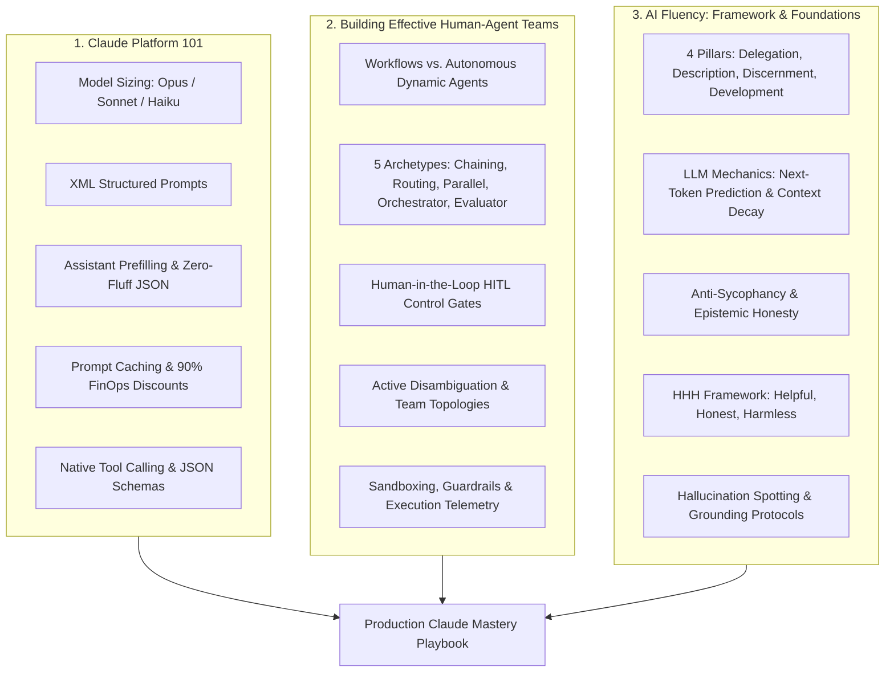

# Anthropic Claude Academy Certification Mastery & Production Playbook

[](https://www.anthropic.com)
[](https://linkedin.com)
[](https://www.python.org)
[](https://github.com/aashiq-parinda/genai-systems-portfolio)

> **The definitive production reference guide, architectural playbook, and battle-tested prompt library** derived from the three official Anthropic Claude Academy certifications earned by **Ashraf Khan**:
> 1. 🎓 **[Claude Platform 101](https://lnkd.in/dapbHhG3)**
> 2. 🎓 **[Building Effective Human-Agent Teams](https://lnkd.in/dhFuzMXc)**
> 3. 🎓 **[AI Fluency: Framework and Foundations](https://lnkd.in/dEKJateU)**

---

## 🗂️ Knowledge Base Structure

```
Anthropic_Claude_Academy_Mastery/
├── README.md                                    # Master curriculum overview & quick navigation (this file)
├── 01_CLAUDE_PLATFORM_101_BEST_PRACTICES.md     # Claude model matrix, XML anatomy, prefilling, prompt caching, tools
├── 02_BUILDING_EFFECTIVE_HUMAN_AGENT_TEAMS.md  # 5 workflow archetypes, ReAct dynamic loop, HITL safety gates, team topologies
├── 03_AI_FLUENCY_FRAMEWORKS_AND_FOUNDATIONS.md # 4 fluency pillars, LLM mental models, sycophancy mitigation, HHH rubric
├── ANTHROPIC_RECOMMENDED_PROMPT_LIBRARY.md     # 12 production-grade XML prompt templates & system prompt blueprints
└── claude_patterns_cookbook.py                 # Executable Python test suite & runnable implementation patterns
```

---

## 🎯 Curricular Overview & Core Competencies



---

## 🚀 Quick Navigation & Modules

### 📘 [01. Claude Platform 101: Recommended Practices](./01_CLAUDE_PLATFORM_101_BEST_PRACTICES.md)
- **Model Family Matrix**: When to choose Opus, Sonnet, or Haiku based on cost, latency, and capability trade-offs.
- **XML Tag Hierarchy**: Why Claude natively thrives on XML tags (`<system>`, `<context>`, `<instructions>`, `<thinking>`, `<output>`).
- **Scratchpad Reasoning**: Forcing hidden or explicit Chain-of-Thought via `<thinking>` tags for complex logic.
- **Assistant Prefilling**: Guaranteeing valid JSON schema and bypassing conversational throat-clearing.
- **Prompt Caching FinOps**: Architecture for caching long system prompts and documentation prefixes for **90% cost savings** and **80% TTFT reduction**.
- **Tool Use / Function Calling**: Best practices for writing descriptive tool docstrings and resilient error loops.

### 🤖 [02. Building Effective Human-Agent Teams](./02_BUILDING_EFFECTIVE_HUMAN_AGENT_TEAMS.md)
- **Workflows vs. Agents**: Why you should start with deterministic DAGs before adopting non-deterministic autonomous loops.
- **5 Canonical Workflow Patterns**:
  1. *Prompt Chaining*
  2. *Routing*
  3. *Parallelization (Sectioning & Voting)*
  4. *Orchestrator-Workers*
  5. *Evaluator-Optimizer Loop*
- **HITL Control Gates**: Approval gates for destructive state mutations, confidence-based escalation, and steering.
- **Team Topologies**: The Pair Collaborator (Copilot), Delegator-Specialist, and Auditor-Worker topologies.
- **Cognitive Load Optimization**: Reducing human reviewer fatigue through clean diffs, summaries, and transparent rationales.

### 🧠 [03. AI Fluency: Frameworks & Foundations](./03_AI_FLUENCY_FRAMEWORKS_AND_FOUNDATIONS.md)
- **The 4 Pillars**:
  1. *Delegation*: Scoping what tasks to hand off vs. what to retain for human judgment.
  2. *Description*: Formulating complete, unambiguous context with negative constraints.
  3. *Discernment*: Active skepticism, grounding checks, and empirical validation.
  4. *Development*: Treating prompts as version-controlled code with test harnesses.
- **LLM Cognitive Realities**: Next-token prediction limits, "Lost in the Middle" attention decay, and the Sycophancy trap.
- **Ethical AI & Constitutional AI**: The HHH (Helpful, Honest, Harmless) framework in daily production engineering.

### 📚 [ANTHROPIC RECOMMENDED PROMPT LIBRARY](./ANTHROPIC_RECOMMENDED_PROMPT_LIBRARY.md)
12 copy-paste production prompt templates:
- **Canonical Master Blueprint**
- **Staff Systems Engineer Code Reviewer**
- **Structured Scratchpad (`<thinking>`)**
- **Zero-Fluff JSON Extraction with Prefill**
- **Anti-Sycophancy & Red-Teaming Critic**
- **HITL Active Disambiguation**
- **Autonomous ReAct Agent with Tool Recovery**
- **Evaluator-Optimizer Dual Loop**
- **Grounded Document Synthesis with Strict Citations**
- **Few-Shot XML Classifier**
- **Prompt Caching Structure Template**
- **Pre-Mutation Safety Gatekeeper**

### 🧪 [Claude Patterns Runnable Python Cookbook](./claude_patterns_cookbook.py)
Runnable standalone script verifying:
- XML prompt formatting and regex parsing.
- Assistant prefill JSON parser.
- Anthropic Prompt Caching ephemeral payload generator.
- Human-in-the-Loop action risk classifier.
- Simulated Evaluator-Optimizer loop.

**Run the cookbook tests directly:**
```bash
python3 Fundamentals_Miscellaneous_Learning/Anthropic_Claude_Academy_Mastery/claude_patterns_cookbook.py
```

---

## 🏆 Credentials & Verification Badges

- **Claude Platform 101**: [Certification Verification Link](https://lnkd.in/dapbHhG3)
- **Building Effective Human-Agent Teams**: [Certification Verification Link](https://lnkd.in/dhFuzMXc)
- **AI Fluency: Framework and Foundations**: [Certification Verification Link](https://lnkd.in/dEKJateU)

*Authored and curated by Ashraf Khan as part of the Generative AI & Systems Engineering Portfolio.*
