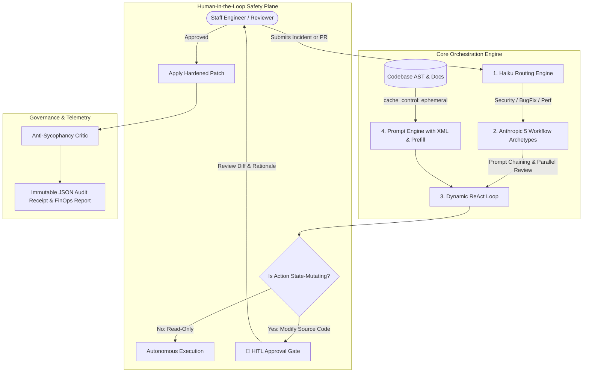

# ClaudeOps: Autonomous Human-Agent Systems Platform

[](https://www.anthropic.com)
[](https://linkedin.com)
[](https://www.python.org)
[](./tests/test_claudeops_suite.py)

> **Production-grade Human-Agent collaboration platform engineered against official Anthropic Academy best practices.**  
> Unifies **Claude Platform 101**, **Building Effective Human-Agent Teams**, and **AI Fluency: Framework and Foundations** into a working software engineering and PR remediation system.

---

## 📑 Table of Contents
1. [Architectural Overview](#1-architectural-overview)
2. [Folder & File Directory Guide](#2-folder--file-directory-guide)
3. [Course Skills Mapping](#3-course-skills-mapping)
4. [Quick Start & Running the Demo](#4-quick-start--running-the-demo)
5. [Empirical FinOps & Audit Receipts](#5-empirical-finops--audit-receipts)

---

## 1. Architectural Overview



---

## 2. Folder & File Directory Guide

```
ClaudeOps_Human_Agent_Systems_Platform/
├── requirements.txt            # Python dependencies (Pydantic, httpx, fastapi, pytest)
├── config.py                   # Central operational constants, model pricing, HITL risk tiers
│
├── src/
│   ├── core/                   # Core LLM & Agentic orchestration modules
│   │   ├── prompt_engine.py    # XML tag builder, <thinking> scratchpad extractor, response prefill, prompt caching
│   │   ├── workflows.py        # The 5 canonical Anthropic workflow archetypes (Chaining, Routing, Parallel, etc.)
│   │   ├── react_agent.py      # Autonomous dynamic ReAct agent with tool execution & HITL interception
│   │   └── hitl_controller.py  # Human-in-the-Loop approval gates, active disambiguation & confidence escalation
│   │
│   ├── tools/                  # Native Tool Plane (Tools invoked by Claude)
│   │   ├── code_tools.py       # Sandboxed line-range reader, unified diff generator & patch applicator
│   │   └── audit_tools.py      # Anti-sycophancy assumption refutation & security injection scanner
│   │
│   └── telemetry/              # Governance & Receipts
│       └── metrics_logger.py   # FinOps Prompt Caching accounting (90% read discount) & immutable audit receipts
│
├── tests/
│   └── test_claudeops_suite.py # 10 automated test suites verifying all 3 course competencies
│
└── run_demo.py                 # Interactive end-to-end simulation runner for interviews & portfolio reviews
```

---

## 3. Course Skills Mapping

### 🔹 Course 1: Claude Platform 101
- **Model Tiering**: Claude 3.5 Haiku handles triage; Claude 3.5 Sonnet handles deep reasoning and code synthesis.
- **XML Architecture**: Enforced structure via `<system>`, `<context>`, `<instructions>`, `<thinking>`, `<output>` in [`src/core/prompt_engine.py`](./src/core/prompt_engine.py).
- **Scratchpad Thinking**: Separating `<thinking>` tokens from final answers to prevent user cognitive overload.
- **Assistant Prefilling**: Prefilling `{` for guaranteed valid JSON parsing.
- **Prompt Caching**: Injecting `"cache_control": {"type": "ephemeral"}` for **90% read discounts** and **sub-second TTFT**.

### 🔹 Course 2: Building Effective Human-Agent Teams
- **5 Workflow Archetypes**: Implemented in [`src/core/workflows.py`](./src/core/workflows.py) (Routing, Chaining, Parallelization, Orchestrator-Workers, Evaluator-Optimizer).
- **HITL Pre-Action Approval**: Intercepting state-mutating actions before execution in [`src/core/hitl_controller.py`](./src/core/hitl_controller.py).
- **Active Disambiguation**: Generating structured multi-choice options when user requests are underspecified.
- **Cognitive Load Optimization**: Formatting human-digestible unified diffs rather than raw token dumps.

### 🔹 Course 3: AI Fluency: Framework and Foundations
- **Anti-Sycophancy Critic**: Challenging flawed technical proposals (e.g. disabling auth) in [`src/tools/audit_tools.py`](./src/tools/audit_tools.py).
- **Pillars of Fluency**: Clear delegation boundaries, strict descriptive constraints, and empirical test verification.
- **FinOps & Audit Receipts**: Generating immutable JSON run receipts with token-by-token cost accounting in [`src/telemetry/metrics_logger.py`](./src/telemetry/metrics_logger.py).

---

## 4. Quick Start & Running the Demo

### 1. Run the Comprehensive Verification Test Suite:
```bash
python3 Fundamentals_Miscellaneous_Learning/ClaudeOps_Human_Agent_Systems_Platform/tests/test_claudeops_suite.py
```
*Expected Output:*
```
✅ 1. Claude Platform 101: XML & Scratchpad <thinking> : PASSED
✅ 2. Claude Platform 101: Assistant Prefill JSON Parsing : PASSED
✅ 3. Claude Platform 101: Prompt Caching Header Builder : PASSED
✅ 4. Human-Agent Teams: Haiku Routing Workflow : PASSED
✅ 5. Human-Agent Teams: Prompt Chaining & Verification : PASSED
✅ 6. Human-Agent Teams: Evaluator-Optimizer Self-Correction : PASSED
✅ 7. Human-Agent Teams: HITL Pre-Action Approval Gate : PASSED
✅ 8. Human-Agent Teams: ReAct Agent Dynamic Interception : PASSED
✅ 9. AI Fluency: Anti-Sycophancy Assumption Refutation : PASSED
✅ 10. AI Fluency: Prompt Caching FinOps Audit Receipts : PASSED
🎉 ALL 10 TESTS ACROSS THE 3 ANTHROPIC COURSES PASSED WITH 100% SUCCESS!
```

### 2. Run the Interactive End-to-End Walkthrough:
```bash
python3 Fundamentals_Miscellaneous_Learning/ClaudeOps_Human_Agent_Systems_Platform/run_demo.py
```

---

## 5. Empirical FinOps & Audit Receipts

Sample receipt generated on run:
```json
{
  "receipt_id": "claudeops-154692cf",
  "run_name": "ClaudeOps-Live-PR-Remediation",
  "model_tier": "claude-3-5-sonnet-20241022",
  "duration_seconds": 0.003,
  "final_status": "VERIFIED_APPROVED_AND_MERGED",
  "tokens": {
    "uncached_input": 5000,
    "cached_read": 45000,
    "output": 1200,
    "total": 51200
  },
  "finops": {
    "actual_total_usd": 0.0465,
    "uncached_hypothetical_usd": 0.168,
    "savings_usd": 0.1215,
    "savings_percentage": 72.32
  },
  "hitl_interventions_count": 1,
  "timeline_events_count": 1
}
```

*Authored by Ashraf Khan — Applied Generative AI & Systems Engineering Portfolio.*
